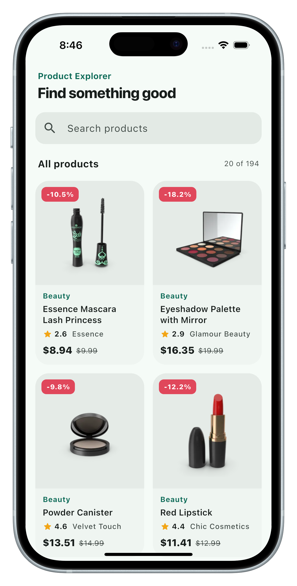
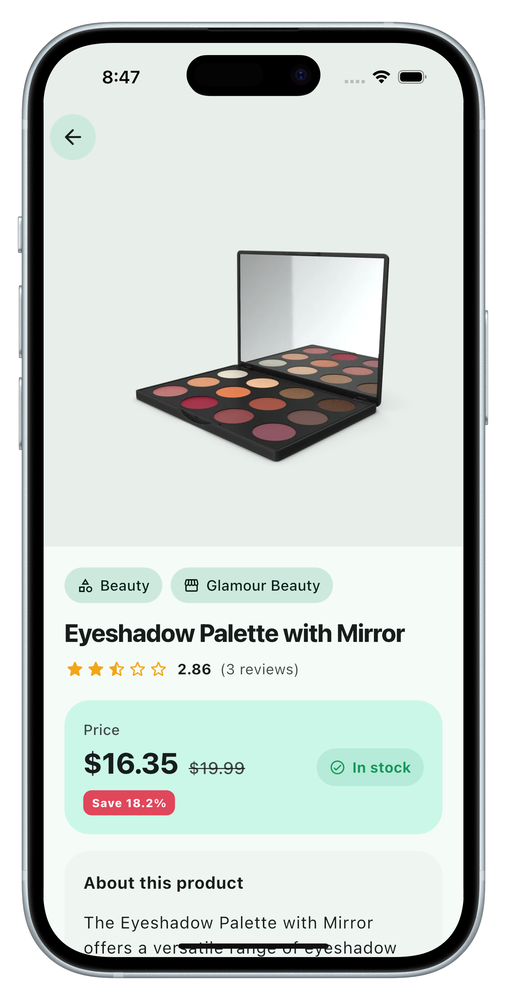
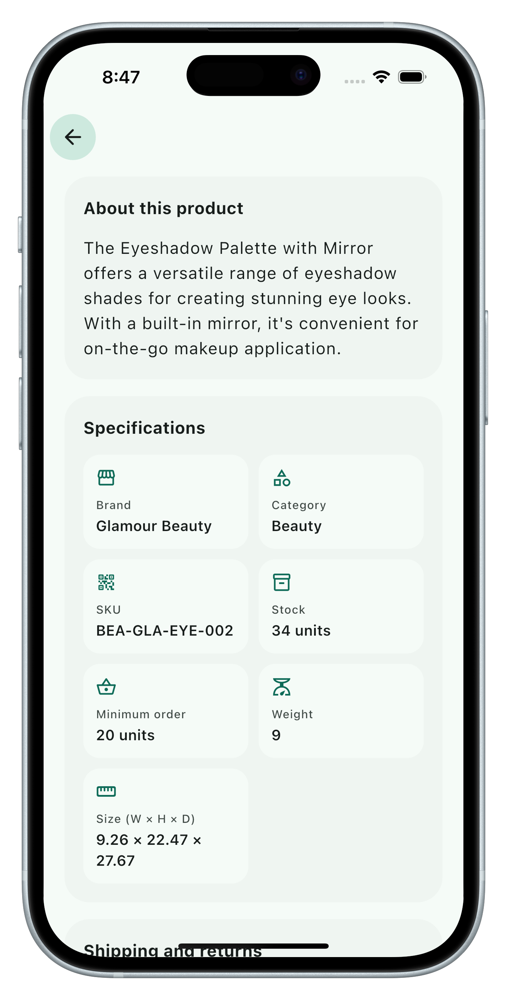
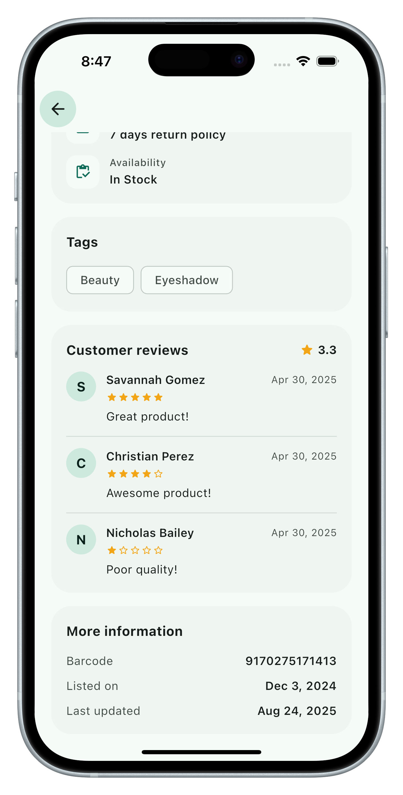

# Product Explorer

A Flutter app for browsing products and viewing product details from the
[DummyJSON Products API](https://dummyjson.com/docs/products).

## Screenshots

| Product listing | Product details | Specifications | Reviews |
| --- | --- | --- | --- |
|  |  |  |  |

## Screen recording

<a href="docs/screenshots/demo.mp4"></a>

Click the image to watch the screen recording: [docs/screenshots/demo.mp4](docs/screenshots/demo.mp4)

## Setup instructions

Requirements: Flutter 3.27 or newer (Dart 3.6+), plus Android Studio or Xcode
for an emulator, simulator or device. Check with `flutter --version`.

```bash
git clone <this-repo-url>
cd product_explorer
flutter pub get
flutter run
```

If the `android/` or `ios/` folders are missing, generate them first with
`./tool/setup_platforms.sh`.

No API keys or secrets are needed; the DummyJSON API is public.

## Test execution steps

```bash
flutter test
```

With coverage: `flutter test --coverage`.

The tests never call the live API. HTTP goes through `package:http`'s
`MockClient` (fake catalogue in `test/helpers/test_helpers.dart`) and the
offline cache uses an in-memory store.

## Architecture overview

Layered architecture, using `provider` for dependency injection and state
management.

```
lib/
├── main.dart                 Composition root: builds the repository and runs the app
├── app.dart                  MaterialApp, theme and providers
├── core/                     Constants, typed errors, theme, formatters, JSON helpers
├── data/
│   ├── models/               Product, ProductPage
│   ├── datasources/          Remote (http) and local (shared_preferences) sources
│   └── repositories/         ProductRepository: network first, cache fallback
└── presentation/
    ├── providers/            ProductListProvider, ProductDetailProvider (ChangeNotifier)
    ├── screens/              ProductListScreen, ProductDetailScreen
    └── widgets/              Reusable UI components
```

```
Screen ──watch──> Provider (ChangeNotifier) ──> ProductRepository
                                                   ├─> ProductRemoteDataSource ─> DummyJSON API
                                                   └─> ProductLocalDataSource  ─> shared_preferences
```

- **Remote data source** builds the requests and maps network, server and
  404 failures to typed exceptions.
- **Repository** decodes responses into models, caches the raw JSON, and falls
  back to the cache when the network or server fails (offline support).
- **Providers** hold UI state (`loading / loaded / empty / error`) and handle
  pagination, search and retry.
- **Widgets** only render state; reusable pieces live in `presentation/widgets`.
